# TP3 · Informe técnico

**Modelado del error de pronóstico — precisión vs. interpretabilidad**

_Taller de Análisis de Datos 1 · Entrega 18/11/2026 · Variable objetivo: `temp_c` · Corrida oficial: 2026-11-15/16
(dataset extendido, 27 días)._

---

## 0. Convención de signo (leer antes que cualquier número)

Todo el trabajo usa

$$e = T_{\text{fcst}} - T_{\text{obs}}$$

es decir, **el error es el pronóstico menos la observación**. Un error positivo significa que el pronóstico
*sobreestimó* la temperatura. La consigna enuncia la diferencia en el orden inverso (observación − pronóstico);
son la misma magnitud con el signo cambiado, y elegimos esta orientación porque es la que hace que la corrección
se escriba como una resta directa sobre el pronóstico:

$$\hat{T}_{\text{corr}} = T_{\text{fcst}} - \hat{e}$$

La equivalencia con la fórmula de la consigna es exacta tomando $\hat{E} = -\hat{e}$. La convención está aplicada
de forma consistente en todas las notebooks 

---

## 1. Resumen ejecutivo

Construimos un modelo de refinamiento (*bias correction*) sobre el pronóstico externo de temperatura. El resultado
central es que **el pronóstico externo ya es bueno, ninguna regla de persistencia logra mejorarlo, y un modelo de
Machine Learning no sólo lo mejora sino que le gana al mejor baseline estadístico disponible**: el Random Forest
reduce el MAE de 1,4435 °C a 1,1410 °C (**−20,96 %**) y el árbol de decisión a 1,2147 °C (**−15,85 %**), ambos
sobre las mismas 47.151 filas de test, contra 1,3299 °C del baseline tipo MOS.

| Métrica (test, n = 47.151) | Sin corregir | Interpretable (árbol) | Mínimo error (Random Forest) |
|---|---|---|---|
| MAE (°C) | 1,4435 | 1,2147 | **1,1410** |
| RMSE (°C) | 1,8311 | 1,5683 | **1,4823** |
| MASE (vs. persistencia) | 0,8066 | 0,6787 | **0,6375** |
| P90 de \|error\| (°C) | 3,0000 | 2,5296 | **2,3695** |
| % de horas con \|error\| < 1 °C | 42,57 % | 50,33 % | **53,32 %** |
| Sesgo medio (°C) | −0,1353 | −0,0177 | +0,0157 |
| Mejora de MAE vs. no corregir | — | −15,85 % | **−20,96 %** |

_Fuente: `data/processed/dashboard/metricas.json` (corrida 2026-11-15)._

Los tres hallazgos que sostienen la narrativa:

1. **El piso exigente no es un baseline ingenuo.** Los 4 baselines de persistencia de la notebook 6 (naive,
   naive estacional, media móvil, drift) pierden contra dejar el pronóstico como está. El que sí corrige es el
   baseline tipo MOS -sesgo medio por estación × hora, MAE 1,330, un 7,9 % mejor que no corregir-, y los dos
   entregables le ganan a él: el árbol por 8,7 % y el Random Forest por 14,2 % (§4).
2. **El error es mayormente autorregresivo y horario.** La historia reciente del error (`error_temp_c_lag6`,
   `error_temp_c_lag24`) y la hora local (`hora_sin`/`hora_cos`) concentran la importancia en las cuatro lecturas
   de interpretabilidad aplicadas y en los dos modelos. La geografía (elevación, distancias, bioma) es marginal.
3. **El sesgo horario del TP2 quedó efectivamente corregido**: las 24 horas del día mejoran, sin excepción, y el
   sesgo medio global cae de −0,135 °C a prácticamente cero.

---

## 2. Datos, cohorte y partición

### 2.1 Dataset

Partimos del dataset fusionado del TP1 (observaciones horarias + pronósticos del NWS + atributos geográficos de
las estaciones). La notebook `5_separacion_train_test.ipynb` arma una tabla única de modelado uniendo por
`station_id` + `target_hour_utc`. La clave es simple porque **el horizonte de pronóstico es constante: 6 h para
todas las filas**, de modo que cada hora objetivo tiene un único pronóstico asociado.

| Concepto | Valor |
|---|---|
| Período cubierto | 2026-10-19 02:00 → 2026-11-15 02:00 UTC (27 días) |
| Estaciones del cohorte | 441 (432 presentes en test) |
| Filas del dataset de modelado | 282.964 tras el merge de la notebook 7 |
| Filas que entran al modelo | 215.312 (**76,1 %**) |
| Train / test | 168.161 / 47.151 filas |

El cohorte de 441 estaciones sale de la exclusión las estaciones con
intermitencia inmanejable antes de cualquier modelado: aquellas que presentan huecos de información en las variables observadas mayores a las 12 horas consecutivas.

### 2.2 Validez del target

No toda fila tiene un error observable. Hubo una indexación en cada estación a la grilla horaria completa y se imputaron los huecos cortos (< 12 h) por interpolación; una fila cuya observación fue imputada **no es un target
legítimo**, porque el "error" sería contra un valor inventado. La columna `target_valido_temp_c` marca esto: el
**79,6 %** de las filas tiene target válido para `temp_c` (87,9 % en test, 77,7 % en train).

La máscara efectiva de modelado exige además que ninguna feature sea NaN, lo que deja el 76,1 % citado arriba. Lo
que se pierde son, sobre todo, filas sin lags disponibles (las primeras horas de cada estación y las posteriores a
cada hueco largo) y filas sin pronóstico asociado.

### 2.3 Partición temporal

Un split aleatorio o un K-fold estándar serían inválidos: la serie tiene autocorrelación horaria alta y un ciclo
diario marcado, así que mezclar filas futuras en train filtra información. Usamos un **corte cronológico único**:

- `CORTE = 2026-11-10` → train = 2026-10-19 a 2026-11-09, test = 2026-11-10 a 2026-11-15.
- Proporción **81 % / 19 %** en filas.
- El corte se recalculó cuando el dataset se extendió de 15 a 27 días: estaba hardcodeado en una fecha que ya no daba el ~80/20 buscado.

Además, **toda feature dinámica mira al menos 6 h hacia atrás**, que es el horizonte del pronóstico: si en el
momento de emitir el pronóstico de las 12 h sólo se conoce lo observado hasta las 06 h, usar `lag1` sería fuga.
Esta restricción es la que explica por qué los lags van en pasos de 6 h y no de 1 h.

---

## 3. Feature engineering

Las features son las mismas para los dos modelos entregados (23 columnas: 20 numéricas, 2 binarias, 1 categórica),
de modo que la comparación precisión/interpretabilidad no esté contaminada por tener distinta información
disponible.

| Grupo | Features | Decisión y evidencia |
|---|---|---|
| Historia del error | `error_temp_c_lag6`, `error_temp_c_lag24`, `error_temp_c_roll3_mean` | Lags elegidos con PACF sobre la serie diferenciada. `lag48` se descartó por redundante con `lag24` |
| Espacial | `error_temp_c_vecinas_lag6_mean` | Media del error de las K vecinas con 6 h de atraso |
| Ciclo diario | `hora_sin`, `hora_cos` | Encoding cíclico; ver ablation en §5.3 |
| Observado con atraso | `obs_rh_pct_lag6`, `obs_dewpoint_c_lag6`, `obs_windspeed_kmh_lag6`, `obs_wind_direction_sin/cos_lag6` | La humedad entró respaldada por CCF diferenciada contra el error; es el único candidato que sobrevivió al control |
| Pronosticado | `fcst_temp_c`, `fcst_pop_pct`, `fcst_rh_pct`, `fcst_windspeed_kmh` | Los tres últimos se agregaron en la revisión de 2026-11-15 y los modelos efectivamente los usan |
| Geografía | `elevation`, `dist_agua_km`, `dist_aeropuerto_km`, `dist_area_urbana_km`, `area_urbana_km2`, `sobre_agua`, `en_area_urbana`, `bioma` | De `4_atributos_geograficos.ipynb` |

**Descartes explícitos**:

- **Ciclo mensual** (`mes_sin`/`mes_cos`): con 27 días de datos sería casi constante. No aporta y agrega ruido.
- **Presión atmosférica**: no existe en las fuentes del TP1.
- **Gradiente direccional de error entre estaciones vecinas**: se diseñó, se implementó la versión barata y se
  evaluó con un gate de validación explícito; no mejoró y se descartó con evidencia. Queda sólo la
  media de vecinas.
- **ARIMA/SARIMA**: descartado porque el panel tiene huecos incompatibles con el enfoque clásico a
  escala de 441 series.

---

## 4. Baselines: qué hay que superar

`6_baselines_globales.ipynb` evalúa cinco opciones sobre una máscara común (filas con target válido y los 4 lags
disponibles), para que todas compitan sobre exactamente las mismas filas.

| Baseline | MAE test (°C) | RMSE test (°C) |
|---|---|---|
| **Cero (no corregir)** | **1,436** | 1,825 |
| Naive estacional (error de la misma hora del día anterior) | 1,591 | 2,076 |
| Media móvil | 1,602 | 2,031 |
| Naive (último error conocido) | 1,788 | 2,287 |
| Drift | 2,961 | 3,768 |

_Evaluados sobre n = 32.214 filas de test (máscara común de los 4 lags)._

**Ninguno de los cuatro le gana a no corregir.** Los cuatro son reglas de persistencia -repetir el último error,
el de ayer a la misma hora, un promedio móvil, una tendencia- y ninguna sirve: el error del pronóstico no se
deja corregir repitiendo su propio pasado sin más.

Pero el baseline realmente exigente de *bias correction* no es ninguno de esos cuatro, sino el clásico tipo MOS:
**el sesgo medio histórico de cada estación a cada hora local**, calculado sobre train y aplicado al test. Se
agregó en la §9.1 de `8_interpretabilidad.ipynb`, evaluado sobre las mismas 47.151 filas que los modelos:

| Opción | MAE test (°C) | vs. no corregir | vs. MOS |
|---|---|---|---|
| Cero (no corregir) | 1,4435 | — | +8,5 % peor |
| **MOS: sesgo medio estación × hora** | **1,3299** | **−7,9 %** | — |
| Árbol de decisión | 1,2147 | −15,9 % | **−8,7 %** |
| Random Forest | 1,1410 | −21,0 % | **−14,2 %** |

_Las 47.151 filas de test se reparten en 10.464 combinaciones estación × hora, todas presentes en train: el MOS
tiene cobertura completa y no necesita respaldo._

**Este baseline sí le gana a no corregir** (−7,9 %), y eso afina el argumento en vez de debilitarlo. Lo que hay
que afirmar con precisión es:

1. La persistencia del error, por sí sola, no corrige nada.
2. Un promedio por estación × hora **sí** corrige: vale **más de un tercio** de toda la ganancia que consigue el
   Random Forest (7,9 de 21,0 puntos). Buena parte del sesgo del pronóstico es estructural -cada estación falla
   de forma parecida a cada hora- y se captura sin ningún modelo.
3. Los dos entregables le ganan **a ese** baseline, no sólo a no corregir: el árbol por 8,7 % y el bosque por
   14,2 %. Esos dos tercios restantes son exactamente lo que aportan las features dinámicas (los lags del error,
   la humedad observada y las variables del pronóstico del día), y son la justificación de haber entrenado un
   modelo en vez de publicar una tabla de sesgos.

> **Nota sobre la cifra de referencia.** El MAE de no corregir vale 1,436 °C sobre las 32.214 filas que evalúa
> la notebook 6 (su máscara exige los 4 lags) y **1,4435 °C sobre las 47.151 filas que ven los modelos**. Este
> informe usa **1,4435** en todas las comparaciones con modelos. La tabla
> `tabla_comparacion_modelos_temp_c.csv` arrastraba el 1,436 hardcodeado y daba 15,4 % para el árbol; se corrigió
> el 2026-11-16 en la §12 de `7_modelado_global.ipynb`, que recalcula los baselines sobre `X_test` sin reentrenar
> nada. **Informe, tabla, notebook 8 y dashboard usan hoy la misma cifra**: 15,853 % para el árbol y 20,957 %
> para el Random Forest.

---

## 5. Modelado y validación

### 5.1 Protocolo

Un único procedimiento (`evaluar_modelo()` en `7_modelado_global.ipynb`) para las 5 familias, de modo que la
comparación sea limpia:

1. **Pipeline cerrado**: preprocesamiento + modelo dentro de un `Pipeline` de scikit-learn, así el escalado y el
   one-hot se ajustan **dentro de cada fold** y no filtran información del fold de validación.
   - Modelos lineales y KNN: `StandardScaler` + `OneHotEncoder(drop='first')`.
   - Modelos de árbol: `passthrough` + `OneHotEncoder(drop='first')`.
2. **Validación cruzada temporal**: `TimeSeriesSplit(n_splits=5)` sobre `X_train` ya ordenado cronológicamente,
   con un `assert` que verifica el orden. Cada fold entrena con el pasado y valida con el futuro inmediato.
3. **Búsqueda de hiperparámetros**: `GridSearchCV` para los modelos baratos y `HalvingRandomSearchCV` para
   Random Forest y Gradient Boosting (el *successive halving* permite explorar un espacio grande descartando
   configuraciones malas con pocos datos).
4. **Test tocado una sola vez**, al final, para reportar.
5. **Dispersión entre ventanas**: se reporta `cv_MAE_std` (el desvío del MAE entre los 5 folds) para la
   combinación ganadora, como control de que el resultado no depende de una ventana afortunada.

### 5.2 Resultados de los 7 modelos

| Modelo | MAE train | MAE test | RMSE test | cv_MAE | cv_MAE_std | MASE | Mejora vs. no corregir |
|---|---|---|---|---|---|---|---|
| **Random Forest** | 0,661 | **1,141** | **1,482** | 1,170 | 0,091 | **0,638** | **−20,96 %** |
| Gradient Boosting | 1,028 | 1,159 | 1,504 | 1,182 | 0,085 | 0,648 | −19,7 % |
| KNN (k=100, distance) | 0,000 | 1,203 | 1,547 | 1,250 | 0,092 | 0,672 | −16,7 % |
| **Árbol de decisión** | 1,172 | **1,215** | 1,568 | 1,264 | 0,095 | 0,679 | **−15,85 %** |
| Ridge (α = 1000) | 1,259 | 1,245 | 1,598 | 1,303 | 0,115 | 0,695 | −13,77 % |
| Elastic Net | 1,279 | 1,268 | 1,620 | 1,280 | 0,105 | 0,708 | −12,2 % |
| Lasso | 1,281 | 1,270 | 1,622 | 1,279 | 0,105 | 0,709 | −12,0 % |
| _Cero (no corregir)_ | — | _1,4435_ | _1,831_ | — | — | _0,807_ | — |
| _Naive estacional (mejor baseline)_ ⁎ | — | _1,591_ | _2,076_ | — | — | _0,889_ | _empeora_ |

⁎ _Los baselines de la notebook 6 se evaluaron sobre otra máscara de filas (n = 32.214), así que su MAE no es
directamente comparable con el de los modelos; se incluyen como referencia de orden de magnitud. Lo que sí es
comparable es el signo: el mejor baseline empeora respecto de no corregir en ambas poblaciones._

_Hiperparámetros ganadores: árbol `max_depth=8, min_samples_leaf=50`; RF `n_estimators=450, max_depth=32,
min_samples_leaf=5, max_features=0,3`; GB `max_iter=450, max_depth=5, learning_rate=0,05, l2=1,0`._

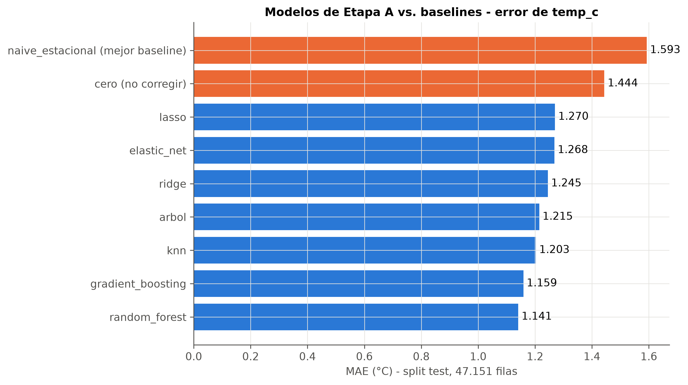

_Figura 1. MAE de test de los 7 modelos contra no corregir._

El **MASE** usa como escala la persistencia del error ($e_{t-6}$, MAE = 1,7897 °C sobre el mismo test):

$$\text{MASE}_{RF} = \frac{1{,}141}{1{,}790} = 0{,}638$$

es decir, el Random Forest comete un **36 % menos de error que repetir el último error conocido**. Los 7 modelos
tienen MASE < 1; los baselines de la notebook 6, salvo "no corregir", no.

### 5.3 Decisiones de modelado con evidencia

- **Encoding de la hora**: se probó `hora_local` categórica (one-hot de 24 columnas) contra el par cíclico
  `hora_sin`/`hora_cos` en los tres modelos de árbol. La cíclica gana en los tres: el árbol empeora **3,14 %**
  (1,215 → 1,253), el RF **1,27 %** y el GB **0,63 %**. Los 24 one-hot dispersan las particiones sin aportar
  información nueva. Se mantiene el encoding cíclico.
- **Elección de los dos entregables**: "mínimo error" = mejor `MAE_test` entre los 5 modelos; "interpretable" =
  mejor `MAE_test` entre los 4 candidatos interpretables (Ridge, Lasso, Elastic Net, árbol). KNN quedó excluido
  del entregable 1 a propósito: no da coeficientes ni importancias, y su `MAE_train = 0` (con
  `weights='distance'`) muestra que memoriza el train.

---

## 6. Comparación: pronóstico externo vs. pronóstico refinado

Esta es la evaluación que pide la Etapa A: error del modelo externo original contra error del modelo refinado.

| | Sin corregir | Árbol | Random Forest |
|---|---|---|---|
| MAE (°C) | 1,4435 | 1,2147 (**−0,229**) | 1,1410 (**−0,303**) |
| % de horas con \|error\| < 1 °C | 42,57 % | 50,33 % | 53,32 % |
| P90 de \|error\| (°C) | 3,00 | 2,53 | 2,37 |
| Sesgo medio (°C) | −0,1353 | −0,0177 | +0,0157 |

Tres lecturas para el tomador de decisiones:

1. **La ganancia promedio es de 0,3 °C**, que suena poco en abstracto pero mueve el porcentaje de horas "dentro
   de 1 °C" de 42,6 % a 53,3 %: **una de cada diez horas cruza el umbral de utilidad práctica**.
2. **El sesgo sistemático desaparece.** El pronóstico externo subestima la temperatura en 0,135 °C en promedio;
   después de corregir, el sesgo residual es ±0,02 °C. El modelo no sólo achica el error, lo centra.
3. **La cola también mejora**: el P90 del error absoluto baja 0,63 °C con el RF. La mejora no es sólo en las horas
   fáciles.

---

## 7. Interpretabilidad

La consigna pide usar "las herramientas adecuadas para cada uno" de los modelos. Usamos tres técnicas, porque
ninguna sola es suficiente:

| Técnica | Dónde aplica | Qué responde | Limitación |
|---|---|---|---|
| `feature_importances_` (impureza) | Árbol | Qué variable usa el modelo para partir | Sesgada hacia variables de alta cardinalidad; no comparable entre familias |
| Coeficientes (Ridge) | Lineal | **Dirección y magnitud** del efecto | Supone linealidad y aditividad |
| Permutation importance | Ambos | Cuánto empeora el modelo si se rompe la variable | Comparable entre familias; se confunde con features correlacionadas |
| SHAP (TreeExplainer) | Ambos | Contribución exacta por fila, global y local | El costo depende del modelo: el árbol admite las 47.151 filas de test en ~2 s; el bosque de 1,1 GB obligó a bajar la muestra a 100 filas |
| Dependence plots (`shap.plots.scatter`) | Árbol | **A partir de qué valor** y en qué dirección actúa cada feature | Sólo sobre el árbol: necesita muchas filas con SHAP calculado |

### 7.1 Modelo interpretable (árbol de decisión, profundidad 8)

El árbol ganador tiene `max_depth=8` y **232 hojas**: es el mejor de los candidatos interpretables por MAE, pero
232 hojas no se leen de un vistazo. La importancia por impureza da el primer resumen -los dos lags del error
concentran el 57 %-, pero es un ranking, no un modelo: dice en qué se apoya el árbol, no cómo decide.

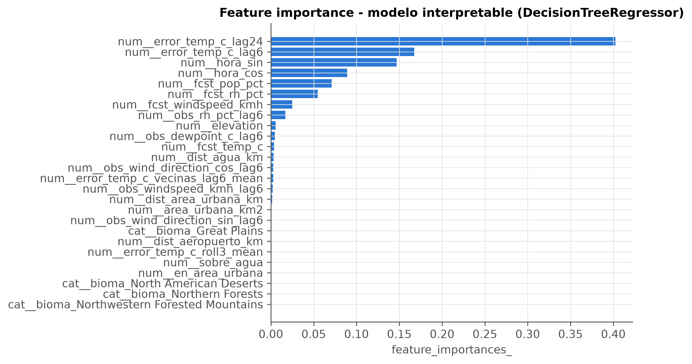

_Figura 2. Importancia por impureza del árbol: los dos lags del error concentran el 57 %._

Para que la palabra "interpretable" signifique algo, la §8 de `8_interpretabilidad.ipynb` agrega dos lecturas:

**(a) Árbol explicativo** (`08_arbol_explicativo_d3.png`): los primeros 3 niveles **del mismo árbol evaluado**,
dibujados con `plot_tree(max_depth=3)`. Es importante entender que esto trunca *la visualización, no el modelo*:
no se entrenó ni se evaluó un árbol más chico, así que las métricas de este informe siguen siendo las del árbol
de profundidad 8. Los nodos grises del gráfico son ramas colapsadas.

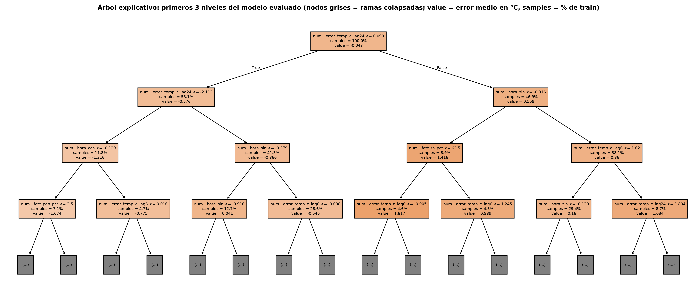

_Figura 3. Primeros 3 niveles del árbol evaluado (visualización truncada, no el modelo)._

La estructura que se lee en esos 3 niveles:

- La **raíz parte por `error_temp_c_lag24 ≤ 0,10 °C`**: lo primero que el modelo pregunta es si ayer, a esta misma
  hora, el pronóstico sobreestimaba o subestimaba.
- El segundo nivel se abre entre **más historia** (`lag24 ≤ −2,11`, la rama de subestimación fuerte) y la **hora
  del día** (`hora_sin ≤ −0,92`, la franja de la tarde-noche).
- El tercer nivel incorpora `hora_cos`, `fcst_rh_pct` (humedad pronosticada) y de nuevo `error_temp_c_lag6`.
- Los nodos muestran el error medio de las filas de train que caen ahí: por ejemplo, la rama de
  `lag24 > 0,10` + tarde-noche + `fcst_rh_pct ≤ 62,5` (8,9 % del train) tiene un error medio de **+1,42 °C**
  -sobreestimación sistemática que el modelo resta-, contra **−1,32 °C** en la rama de subestimación fuerte
  (`lag24 ≤ −2,11` + `hora_cos ≤ −0,13`, 11,8 % del train).

Una advertencia honesta de lectura: los cortes de hora están sobre las features cíclicas, así que no se leen
directamente. `hora_sin ≤ −0,92` es la franja de ~16 a 20 h local, y `hora_cos ≤ −0,13` es ~7 a 17 h. La notebook
incluye la tabla de equivalencias.

**(b) Ridge como segunda lectura** (`09_coeficientes_ridge.png`): el árbol dice *qué* variables usa, pero no *en
qué dirección*. Ridge (α = 1000, MAE 1,245 — sólo 0,03 °C peor que el árbol) sí:

| Feature (estandarizada) | Coeficiente (°C por desvío estándar) |
|---|---|
| `error_temp_c_lag6` | **+0,618** |
| `error_temp_c_lag24` | **+0,576** |
| `hora_sin` | −0,261 |
| `error_temp_c_roll3_mean` | −0,223 |
| `obs_dewpoint_c_lag6` | +0,222 |
| `fcst_temp_c` | −0,204 |
| `fcst_rh_pct` | −0,194 |
| `fcst_windspeed_kmh` | −0,186 |

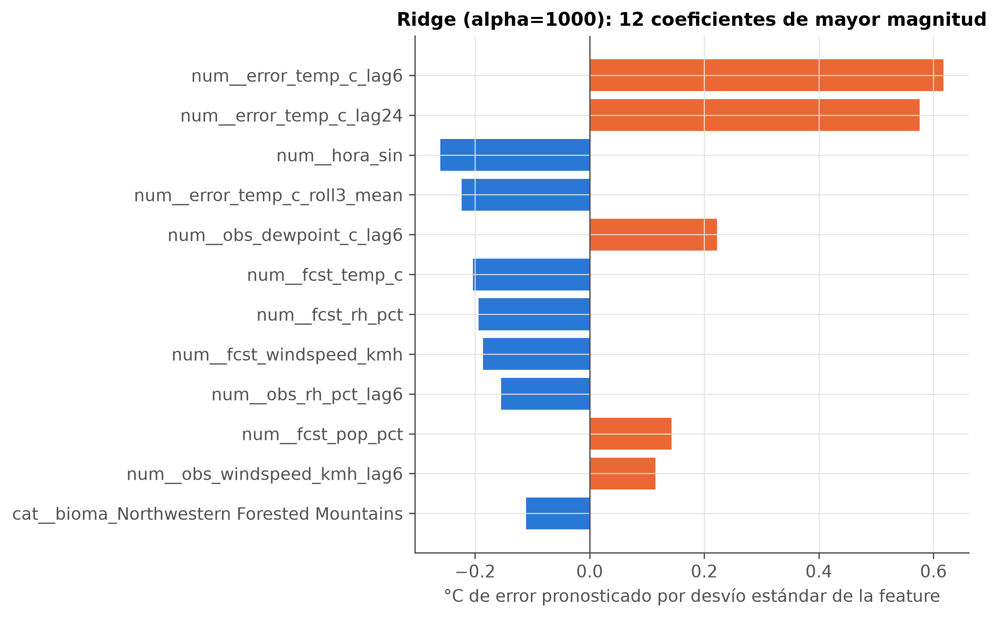

_Figura 4. Coeficientes de Ridge: dirección y magnitud del efecto de cada feature._

Los dos lags entran con **signo positivo**: si el pronóstico venía sobreestimando, lo más probable es que siga
sobreestimando. Es persistencia del error, y es el mecanismo central del modelo. El signo negativo de
`fcst_windspeed_kmh` dice que **con viento pronosticado alto el pronóstico tiende a sobreestimar menos** (el
viento mezcla la capa límite y reduce los extremos locales que el modelo global no resuelve). Nada de esto es
legible en un árbol.

**(c) SHAP del árbol sobre el test completo** (`11_shap_summary_arbol.png`). A diferencia del Random Forest,
acá no hace falta muestrear: TreeSHAP escala con (nº de árboles × hojas × profundidad²), y el árbol es
1 × 232 × 8 contra 450 × ~17.000 × 32 del bosque — unas 5 × 10⁵ veces más barato por fila. Las 47.151 filas de
test se calculan en ~2 s, así que el beeswarm del modelo interpretable **no tiene el problema estadístico** del
de §7.2.

| Feature | \|SHAP\| promedio (°C) |
|---|---|
| `error_temp_c_lag24` | 0,460 |
| `hora_sin` | 0,327 |
| `error_temp_c_lag6` | 0,283 |
| `hora_cos` | 0,159 |
| `fcst_rh_pct` | 0,098 |
| `fcst_pop_pct` | 0,095 |

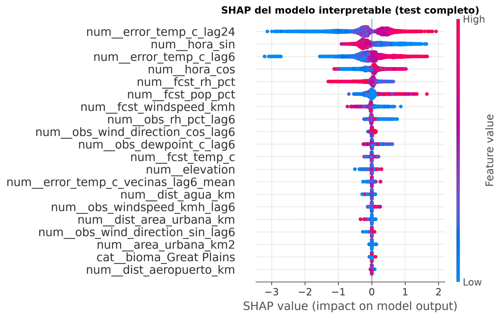

_Figura 5. SHAP del árbol sobre las 47.151 filas de test (sin muestreo)._

**(d) Dependence plots** (`12`-`14_dependence_*.png`), que son los que muestran *a partir de qué valor* actúa
cada variable:

- **`hora_sin`**: la contribución llega a **+1,6 °C** en la tarde-noche (`hora_sin ≈ −1`, las ~18 h locales) y
  cae a cero o negativa alrededor del amanecer (`hora_sin ≈ +1`, las ~6 h). El modelo aprendió que a esa hora el
  pronóstico sobreestima, y le resta.
- **`error_temp_c_lag24`**: relación monótona creciente — la persistencia del error, el mismo mecanismo que
  Ridge resume en su coeficiente +0,576.
- **`fcst_pop_pct`**: el efecto se concentra en los valores altos de PoP, coherente con el corte de lluvia de
  §8.4.

_Figura 6. Dependence plot de `hora_sin`._

_Figura 7. Dependence plot de `error_temp_c_lag24`._

_Figura 8. Dependence plot de `fcst_pop_pct`._

Los puntos aparecen alineados en columnas verticales porque un árbol es una función escalonada: dentro de cada
hoja, todas las filas reciben exactamente la misma contribución. Es una diferencia visible contra los dependence
plots de un modelo continuo, y conviene anticiparla al jurado.

### 7.2 Modelo de mínimo error (Random Forest)

SHAP global (`TreeExplainer`, muestra de 100 filas de test), medido como |SHAP| promedio:

| Feature | \|SHAP\| promedio (°C) |
|---|---|
| `error_temp_c_lag24` | 0,330 |
| `hora_sin` | 0,300 |
| `error_temp_c_lag6` | 0,208 |
| `hora_cos` | 0,187 |
| `fcst_rh_pct` | 0,116 |
| `fcst_pop_pct` | 0,102 |
| `fcst_windspeed_kmh` | 0,090 |

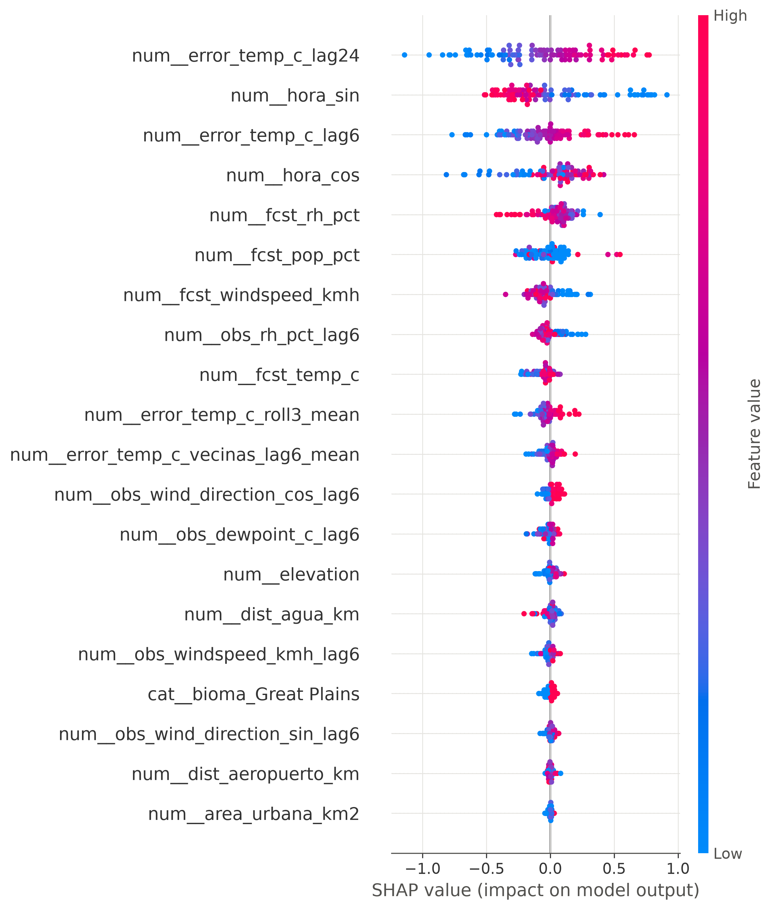

_Figura 9. SHAP del Random Forest (muestra de 100 filas; ver la limitación en §11)._

### 7.3 Qué dicen los dos modelos juntos

Agrupando las features en bloques, los dos modelos reparten su atención distinto — y eso es un hallazgo, no un
detalle técnico:

| Bloque | Árbol (impureza) | Árbol (SHAP) | Árbol (permutación) | RF (SHAP) | RF (permutación) |
|---|---|---|---|---|---|
| Historia del error (`lag6`+`lag24`) | **57,0 %** | 46,8 % | 41,8 % | 29,8 % | 29,9 % |
| Hora del día (`hora_sin`+`hora_cos`) | 23,6 % | 30,5 % | 41,1 % | 26,9 % | **38,5 %** |
| Pronóstico (`fcst_*`) | 15,4 % | 16,8 % | 15,0 % | 20,5 % | 20,3 % |
| Geografía (elevación, distancias, bioma, urbano/agua) | 1,1 % | 1,4 % | 0,2 % | 6,8 % | 3,6 % |
| Resto (observado con atraso, media móvil, vecinas) | 2,9 % | 4,5 % | 1,9 % | 16,0 % | 7,7 % |

_Cada columna está normalizada sobre su propio total: las escalas no son comparables entre técnicas (la impureza
suma 1, el \|SHAP\| está en °C y la permutación en °C de degradación), pero el reparto interno sí lo es._

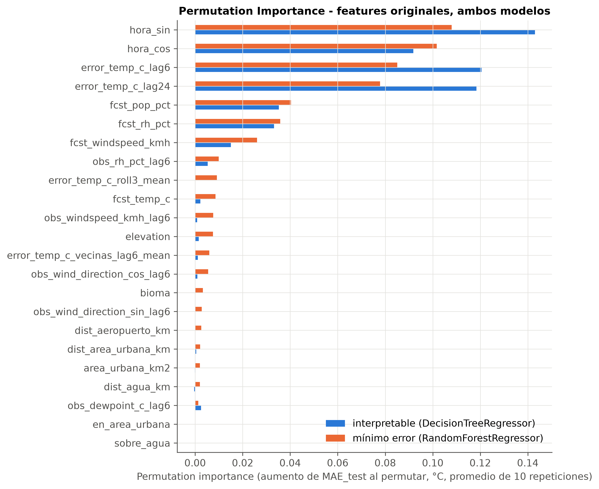

_Figura 10. Permutation importance de los dos modelos, la única lectura comparable entre familias._

- **El árbol es un modelo de persistencia del error**: el 57 % de su importancia por impureza está en dos lags.
  Su lógica es "ayer a esta hora el pronóstico fallaba así, hoy probablemente también".
- **El Random Forest explota más el ciclo diario**: por permutación, la hora le gana a la historia (38,5 % vs.
  29,9 %), mientras que en el árbol las dos están empatadas. Con 450 árboles puede modelar interacciones
  hora × condición que un solo árbol de profundidad 8 no alcanza, y de ahí sale buena parte de los 0,07 °C de
  diferencia entre ambos.
- **El Random Forest reparte más**: el bloque "resto" (humedad y viento observados con atraso, media móvil,
  vecinas) pesa 16 % en SHAP contra 2,9 % en el árbol. El árbol concentra, el bosque distribuye — que es
  justamente lo que lo hace más preciso y menos legible.
- **La geografía es marginal en las cuatro lecturas** (nunca supera el 6,8 %, y es prácticamente nula en el
  árbol). Es un resultado negativo valioso: el error del pronóstico es un fenómeno temporal, no espacial. Las
  estaciones no fallan distinto *por dónde están*, fallan distinto *por cuándo es* — con la excepción del bioma
  de montaña (§8.2).

### 7.4 SHAP local: una predicción que el modelo no podía acertar

Caso **E7246, 2026-11-13 20:00 UTC (13 h local)**, dentro de la ventana problemática del mediodía:

- Error real del pronóstico: **+7,22 °C** (sobreestimación enorme).
- Predicción del modelo: **−1,50 °C** (esperaba una subestimación leve).
- Residuo: **8,72 °C**.

El waterfall de SHAP muestra por qué: partiendo del valor base (−0,043 °C, la predicción promedio del modelo),
**todas las contribuciones grandes empujan hacia abajo** — `error_temp_c_lag6` (−0,26), `hora_cos` (−0,25),
`fcst_pop_pct` (−0,23), `dist_agua_km` (−0,22). Ninguna feature disponible contenía la señal de que ese pronóstico
iba a fallar por 7 °C.

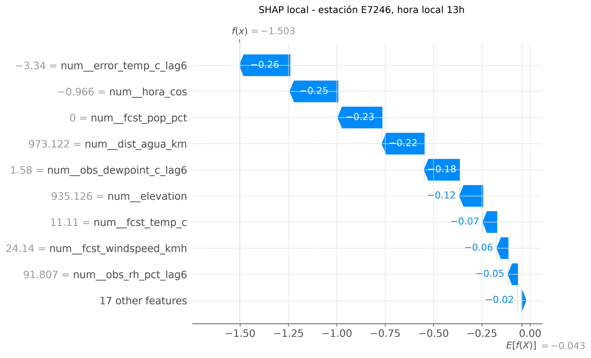

_Figura 11. Waterfall de SHAP del caso E7246: todas las contribuciones empujan en la dirección equivocada._

La lectura para el informe es honesta: **este tipo de evento no es corregible con esta información**. Es una
anomalía meteorológica puntual (probablemente un frente o una tormenta que el modelo global no resolvió), y el
corrector sólo puede capturar el error *sistemático*, no el impredecible. Esto es exactamente lo que justifica el
tratamiento de incertidumbre de §9: si no se puede predecir el evento, hay que comunicar su posibilidad.

---

## 8. ¿Se corrigió el sesgo detectado en la Etapa A?

### 8.1 Sesgo horario — corregido

El TP2 identificó un sesgo diurno: el pronóstico falla distinto según la hora. Comparación pre/post por hora local
(MAE del error sin corregir vs. MAE del residuo de cada modelo):

| | Sin corregir | Árbol | RF | Mejora RF |
|---|---|---|---|---|
| Mejor hora (8 h local) | 1,80 | 1,21 | 1,09 | **+39,3 %** |
| Peor hora (15 h local) | 1,16 | 1,13 | 1,06 | +8,6 % |
| Promedio de las 24 h | 1,44 | 1,22 | 1,14 | +20,5 % |

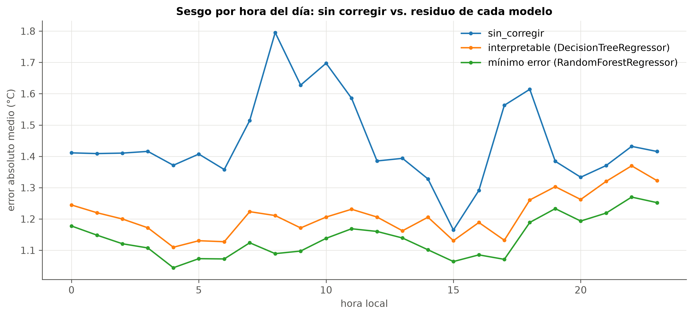

_Figura 12. Sesgo por hora local, pre y post corrección: las 24 horas mejoran._

**Las 24 horas del día mejoran, sin excepción**, con ambos modelos. Esto cambió respecto de la corrida anterior
(dataset de 15 días), donde había un puñado de horas en que el modelo quedaba *peor* que no corregir: ese
problema ya no existe.

Las horas de mayor ganancia son las de la mañana (7-11 h: +26 a +39 %), que son justamente las de peor pronóstico
base (MAE 1,51-1,80 °C). Las de menor ganancia son **15-16 h (+8,6 % y +15,9 %) y la franja nocturna 19-23 h
(+10,5 a +11,5 %)**, que son horas donde el pronóstico base ya era relativamente bueno.

### 8.2 Sesgo geográfico — corregido parcialmente

| Bioma | Sin corregir | Árbol | RF | Mejora RF |
|---|---|---|---|---|
| Northwestern Forested Mountains | **2,17** | 1,86 | **1,84** | +15,3 % |
| Great Plains | 1,47 | 1,22 | 1,16 | +21,1 % |
| Eastern Temperate Forests | 1,42 | 1,20 | 1,11 | +21,8 % |
| Northern Forests | 1,41 | 1,26 | 1,15 | +18,4 % |
| North American Deserts | 1,18 | 1,06 | 0,98 | +17,5 % |

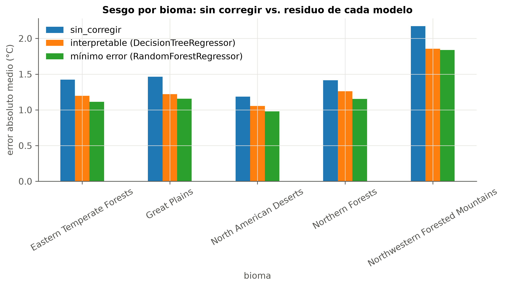

_Figura 13. Sesgo por bioma, pre y post corrección._

El bioma de montaña es, con diferencia, el más difícil: 2,17 °C de MAE base contra 1,18-1,47 del resto, y es
también donde el modelo gana menos (+15,3 %). La brecha entre el mejor y el peor bioma se achica de **0,99 °C a
0,86 °C**: el modelo reduce la desigualdad geográfica, pero no la elimina. Tiene sentido — la corrección
estadística no puede suplir la falta de resolución orográfica del modelo físico subyacente.

### 8.3 Mecanismo: por qué el mediodía es distinto

La correlación entre `error_temp_c_lag6` y el error real, calculada por hora local, **colapsa entre las 10 y las
13 h**:

| Hora local | 5 h | 8 h | 10 h | 12 h | 13 h | 15 h | 17 h |
|---|---|---|---|---|---|---|---|
| ρ(`lag6`, error) | 0,59 | 0,39 | −0,01 | −0,10 | −0,10 | 0,38 | 0,32 |

_Figura 14. Colapso de ρ(`error_temp_c_lag6`, error) en el cruce por cero del ciclo diario._

La feature en la que más confía el modelo deja de servir justo cuando el ciclo diario cruza por cero. El modelo
compensa apoyándose en `hora_sin`/`hora_cos` y en las variables de pronóstico, que es por qué la ventana sigue
mejorando pese al colapso; pero el margen es más chico y la varianza del residuo más alta. Es también la ventana
donde cae el caso de §7.4.

### 8.4 Lluvia y viento: los otros dos sesgos del TP2

| Corte | Sin corregir | Árbol | RF | Mejora RF |
|---|---|---|---|---|
| `pop < 30 %` (n = 45.126) | 1,450 | 1,217 | 1,145 | +21,1 % |
| **`pop ≥ 30 %`** (n = 2.025) | **1,297** | 1,161 | 1,057 | +18,5 % |
| Viento bajo (n = 25.370) | 1,512 | 1,242 | 1,165 | +23,0 % |
| Viento medio (n = 6.238) | 1,421 | 1,196 | 1,136 | +20,1 % |
| **Viento alto** (n = 15.543) | **1,341** | 1,177 | 1,104 | +17,6 % |

_`8_interpretabilidad.ipynb` §9.2, umbral de PoP = 30 % (el ejemplo de la consigna), terciles de
`fcst_windspeed_kmh`._

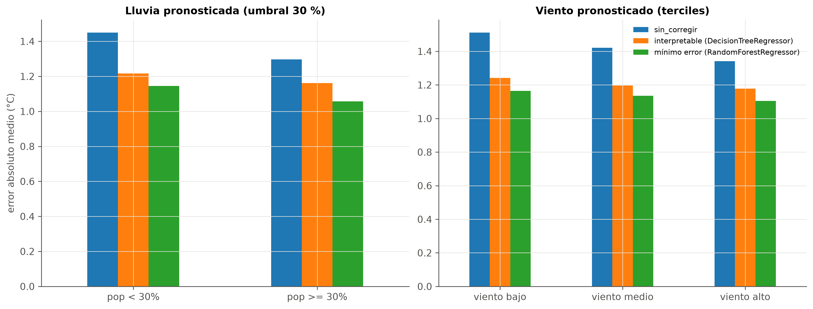

_Figura 15. Sesgo por corte de lluvia y de viento, pre y post corrección._

El resultado es contraintuitivo y vale la pena decirlo así: **en las horas con lluvia pronosticada el pronóstico
base falla menos, no más** (1,297 contra 1,450 °C), y lo mismo pasa con viento alto (1,341 contra 1,512 del
tercil bajo). La explicación física es razonable: nubosidad y viento reducen la amplitud térmica diaria, y la
amplitud es justamente lo que hace fallar al pronóstico -el mismo mecanismo que explica por qué las horas de peor
pronóstico son las de la mañana (§8.1).

Los dos modelos mejoran en los cinco cortes, sin excepción, pero **mejoran menos donde el pronóstico ya venía
bien**: +18,5 % con lluvia contra +21,1 % sin lluvia, +17,6 % con viento alto contra +23,0 % con viento bajo. Es
el mismo patrón que por hora del día.

Dos cautelas al citar estas cifras: (a) `pop ≥ 30 %` son sólo **2.025 filas, el 4,3 % del test**, así que la
señal de lluvia es débil; (b) los terciles de viento quedan desbalanceados porque `fcst_windspeed_kmh` tiene
muchos valores repetidos y `qcut` no puede partir los empates.

El signo coincide con lo que ya decía el coeficiente de `fcst_windspeed_kmh` en Ridge (−0,186, §7.1): más viento
pronosticado, menos sobreestimación. Dos técnicas independientes, la misma conclusión.

---

## 9. Incertidumbre: banda conformal del 80 %

Un valor puntual corregido oculta el riesgo, y la decisión de un usuario (un productor agropecuario, por ejemplo)
depende del peor caso plausible, no del promedio. Por eso el precómputo del dashboard genera un **intervalo del
80 % estilo split-conformal por (bioma, franja horaria)**.

El punto metodológico importante: split-conformal necesita un set de calibración que el modelo no haya visto.
Reentrenar dejando una ventana afuera era inviable (el bosque pesa 1,1 GB), así que **partimos el test en dos
tramos cronológicos**: 2 días de calibración y 3 de evaluación, midiendo la cobertura sólo fuera del tramo de
calibración.

| Métrica | Valor |
|---|---|
| Nivel nominal | 80 % |
| **Cobertura observada** | **81,3 %** |
| Ancho medio de la banda | 3,72 °C (≈ ±1,9 °C) |

La banda calibra bien (81,3 % contra 80 % nominal). Y el dato que vale la pena contar: **±1,9 °C de banda contra
1,14 °C de MAE**. El error típico es chico, pero el rango plausible no lo es — exactamente la lección del caso
E7246.

---

## 10. La discusión central: precisión vs. interpretabilidad

| Dimensión | Árbol de decisión (entregable 1) | Random Forest (entregable 2) |
|---|---|---|
| MAE test | 1,215 °C | **1,141 °C** |
| Mejora vs. no corregir | 15,85 % | **20,96 %** |
| Tamaño del artefacto | **38 KB** | 1,1 GB (≈ 29.000×) |
| Explicación | Reglas legibles + coeficientes de Ridge como apoyo | SHAP (costoso) |
| Costo de explicar una predicción | Recorrer 8 decisiones | TreeSHAP: muestra limitada a 100 filas |
| Sobreajuste (MAE train → test) | 1,172 → 1,215 (**+3,7 %**) | 0,661 → 1,141 (**+72,6 %**) |
| Auditable por un no técnico | Sí | No |

**El costo de la interpretabilidad es 0,074 °C de MAE** (5,1 puntos porcentuales de mejora). Dicho de otro modo:
el árbol captura **el 76 % de la ganancia** que logra el Random Forest, con un artefacto 29.000 veces más chico y
una explicación que cabe en una figura.

Tres consideraciones que matizan la elección:

1. **El Random Forest está claramente sobreajustado**: MAE 0,661 en train contra 1,141 en test. Generaliza bien en
   términos absolutos, pero su capacidad está siendo usada en parte para memorizar. El árbol, con
   `min_samples_leaf=50`, casi no tiene brecha train/test.
2. **Gradient Boosting es la alternativa práctica desaprovechada**: MAE 1,159, a sólo **0,018 °C** del Random
   Forest, con un modelo órdenes de magnitud más liviano y desplegable. Si el criterio fuera "mínimo error
   desplegable" en vez de "mínimo error", el entregable 2 debería ser GB.
3. **El peso del modelo tuvo consecuencias metodológicas reales**, no sólo de infraestructura: forzó a bajar la
   muestra de SHAP de 500 a 100 filas e impidió reentrenar para la calibración conformal. La interpretabilidad y
   la precisión no son sólo un tradeoff de métricas: el modelo más preciso es también el más difícil de auditar.

---

## 11. Limitaciones y amenazas a la validez

Ordenadas por impacto sobre las conclusiones:

1. **Un único holdout de 5 días.** No hay walk-forward: el test es una sola ventana (10-15 de noviembre). Se
   mitiga reportando `cv_MAE_std` (dispersión de 7-9 % entre folds), pero un período meteorológicamente atípico
   movería los números. Es la limitación más seria.
2. **El test también eligió la familia de modelos.** El ganador se seleccionó por `MAE_test`, no por `cv_MAE`, lo
   que introduce un sesgo optimista de selección. El ranking por `cv_MAE` coincide en la cima (RF 1,170 < GB 1,182
   < KNN 1,250 < árbol 1,264), así que la conclusión no cambia, pero la cifra de test es optimista como estimador
   insesgado.
3. **Folds de CV partidos por posición de fila.** `TimeSeriesSplit` corta el panel apilado por índice, no por
   timestamp: una misma `target_hour_utc` puede quedar a ambos lados de un corte y, como las estaciones están
   correlacionadas espacialmente, hay una fuga mínima dentro de la CV. No afecta al holdout final.
4. **El margen sobre el baseline MOS es la cifra honesta**, no el margen sobre no corregir: el Random Forest
   mejora 21,0 % contra el pronóstico crudo, pero sólo 14,2 % contra un promedio por estación × hora. Es la
   comparación que hay que mirar para juzgar si valió la pena entrenar un modelo.
5. **27 días de datos.** Sin ciclo estacional, sin variedad sinóptica. El modelo aprendió el régimen de
   octubre-noviembre; no hay evidencia de que generalice a otra estación del año.
6. **El SHAP del Random Forest sigue sobre 100 filas de 47.151.** El beeswarm del modelo de mínimo error es
   estadísticamente pobre para las features de cola; el orden del top-4 es robusto, el resto no debe leerse como
   un ranking firme. El del árbol sí usa el test completo (§7.1), así que la lectura fina de interpretabilidad
   hay que apoyarla en ése.
7. **El target se calcula también sobre observaciones imputadas** por interpolación corta (< 12 h). El efecto
   está cuantificado en la auditoría y es menor, y el dashboard tiene un filtro para excluir esas filas; aun así,
   una fracción del "error" que el modelo aprende se mide contra un valor interpolado, no observado.
8. **La señal de lluvia es débil**: 2.025 filas con `pop ≥ 30 %` sobre 47.151 (§8.4). La dirección del efecto
   es consistente con el coeficiente de viento de Ridge, pero no es una muestra para sacar conclusiones fuertes.

---

## 12. Trabajo futuro

- Selección del modelo final por `cv_MAE` en vez de `MAE_test`, o demostración de que el ranking coincide.
- Más filas de SHAP para el Random Forest (hoy 100): exige un modelo más liviano, por ejemplo el Gradient
  Boosting.
- Un baseline MOS más fino (estación × hora × condición de cielo) para ver cuánto más del margen del modelo es
  estructural.
- Validación walk-forward sobre varias ventanas de test.
- *Shrinkage* del corrector hacia 0 en las horas donde ρ(`lag6`, error) colapsa.
- Un segundo modelo con `windspeed_kmh` como target, para cerrar el tercer sesgo del TP2.

---

## Anexo A · Reproducibilidad

| Notebook | Rol |
|---|---|
| `1_analisis_estaciones.ipynb` · `4_atributos_geograficos.ipynb` | Cohorte de estaciones y atributos geográficos |
| `2_relaciones-bivariadas.ipynb` · `3_analisis_temporal.ipynb` · `3b_correlaciones_error_temp_c.ipynb` | EDA, feature engineering, ACF/PACF/CCF |
| `5_separacion_train_test.ipynb` | Dataset de modelado, validez del target, split temporal |
| `6_baselines_globales.ipynb` | Los 5 baselines |
| **`7_modelado_global.ipynb`** | **Entregables 1 y 2**: pipelines, CV temporal, tuning, métricas |
| **`8_interpretabilidad.ipynb`** | **Etapa B**: importancias, SHAP, sesgos pre/post, árbol explicativo, Ridge |
| `dashboard/precomputo.py` · `dashboard/app.py` | **Entregable 4** |

**Figuras y tablas citadas**: las 15 figuras de este informe están incrustadas arriba y **versionadas** en
`data/out/modelado_global/` y `data/out/interpretabilidad/`, junto con las `tabla_*.csv` de las que salen sus
números -son los dos únicos directorios de `data/out/` dentro de git (excepción explícita en el `.gitignore`),
para que el informe se lea completo en un clon limpio. El resto de `data/out/` no se versiona: esas figuras se
ven dentro de los outputs de las notebooks que las generan, y se regeneran corriendo las notebooks en orden.

**Cifras oficiales**: `data/processed/dashboard/metricas.json` (sí versionado). Toda métrica de este informe sale
de ahí o de las tablas de `data/out/`, con una única excepción declarada en §4 (el 1,436 de la notebook 6).

---

## Anexo B · Glosario de métricas

- **MAE**: error absoluto medio, en °C. La métrica principal, por robustez a outliers y lectura directa.
- **RMSE**: penaliza más los errores grandes; se reporta para mostrar que la mejora no viene de achicar sólo los
  errores chicos.
- **MASE**: MAE del modelo dividido por el MAE de la persistencia del error ($e_{t-6}$ = 1,7897 °C). MASE < 1
  significa ganarle a repetir el último error conocido.
- **P90 de |error|**: el percentil 90 del error absoluto; mide la cola.
- **Sesgo medio**: promedio con signo del error. Mide si el pronóstico (o el residuo) está sistemáticamente
  corrido.
- **Cobertura conformal**: porcentaje de observaciones reales que caen dentro de la banda del 80 %.
